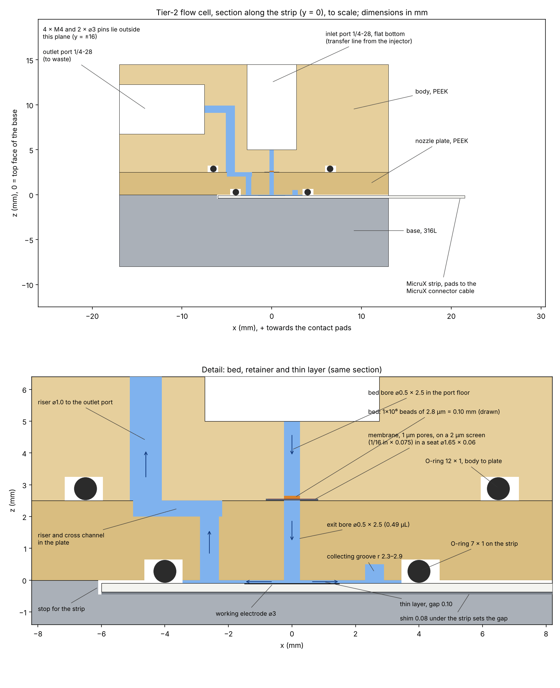

# 34 — A custom flow cell for tier 2, with the bead bed inside the cell

Status: 2026-11-18. Follow-up to the tier round (docs/26–33) on the user's request: "Let's design a custom flow
cell for tier 2. What type of beads? I'd like the bead bed to be part of the flow cell not the inlet tubing. It
should handle 500 psi. Ideally all custom parts can be ordered from a place like Xometry." Written by the
orchestrator without agents. **Desk work, not independently reviewed; nothing is ordered.**

Where the numbers come from:
* Dimensions: `cad/elisa_cad/tier2_cell/params.py`, the one file that the CAD model and the calculation read.
* CAD: `cad/elisa_cad/tier2_cell/` → `cad/out/tier2_cell/` (STEP files of the three custom parts and of the
  assembly, renders, the section below, notes for the drawings, 24 checks, all pass).
* Model, pressure drop, mechanics: `scripts/tier_round/tier2_cell.py` → `results/tier_round/tier2_cell.md`,
  `.json` (7 checks, all pass; about 1 min). The assay is the unchanged tier 2 of docs/30; only the bed holder, the retainer,
  the walls around the bed and the cell are replaced. `tierkit.py`, `designs.py`, `src/` and `params/` are not
  edited.

Every LOD is a model prediction with the kit and parameters of docs/30, not a measurement. "Nominal" = all
parameters at their best estimate; "median [5–95 %]" = Monte Carlo over the parameter bounds (n = 2000). Evidence
labels as in docs/28: **[V]** page or document opened in this session, **[S]** search summary only, **Derived**,
**UNVERIFIED**. **Gap** = height of the liquid layer over the working electrode. **Retainer** = whatever holds the
beads back while the liquid passes.

## 0. Summary

**Beads: stay with Dynabeads M-280 Streptavidin, 2.8 µm (11205D), 1×10⁶ per determination.** They are the surface
on which the project's non-specific-binding rate is defined, and the model finds no better size: at equal bead
area the captured fraction is the same from 1 to 20 µm (63–66 %), because capture is limited by the binding
reaction and not by transport to the bead. What the bead size does decide is the retainer (next point). A second
bead fits the same cell without change and is the fallback: non-porous streptavidin polystyrene of 10–14 µm.

**The retainer is the part that needed a new answer.** The stainless screens sold for HPLC filters are rated
nominally: the vendor states that its 1 µm screen is absolute only at 6–7 µm and its 2 µm screen at 7–8 µm [V].
Neither holds 2.8 µm beads safely. A sintered 0.5 µm frit does, but its inner surface takes up conjugate: with
40 mm² the model LOD is 5.0 pg/mL. The design therefore uses a **track-etched membrane with 1 µm pores lying on
the 2 µm screen**: the membrane retains, the screen carries it. The 10–14 µm beads need the screen alone.

**The cell** is a stack of three machined parts, 30 × 44 × 22.5 mm (figure in section 4):

| Part | Material | What it carries |
|---|---|---|
| Body | PEEK | inlet port on top; the port floor is 2.5 mm thick and the **bed bore (0.5 mm) runs through it**, so the bed sits in the body; seat for the retainer in the underside; outlet port on the end face |
| Nozzle plate | PEEK | clamps the retainer against the body; exit bore (0.5 mm) to the electrode; its underside is the lid of the thin layer, with the O-ring that seals on the strip and a collecting groove around the electrode |
| Base | 316L stainless | pocket that locates the MicruX strip and sets the gap (0.10 mm) with a shim |

The bed is 2.6 mm above the working electrode with 0.49 µL between them, the same dead volume as docs/30. The
MicruX strips, their connector cable and the 1/4-28 fittings in hand are used as they are. There is no magnet in
the cell, so the concern of docs/30 §4.2 (step 4) about the magnets of the MicruX add-on does not arise.

**500 psi.** The whole liquid path, including the seal on the strip, is laid out for 500 psi (34.5 bar): the four
M4 screws hold 2.9 times the force that pressure produces, and the thinnest wall beside a bore is 0.9 mm. In use the
cell needs far less. With the bed in a 0.5 mm bore the pressure drop of the whole cell is 1.0 bar at 80 µL/min
and 2.5 bar at 200 µL/min (docs/30: 25 bar across the bed at 80 µL/min, because its capillary is 0.2 mm). **Not
shown by calculation: that an O-ring seals on a printed strip at 500 psi.** That needs a proof test (section 8).

**Xometry.** All three custom parts are plain 3-axis milling. Every hole is ≥ 0.5 mm, the feature size Xometry
recommends as its minimum [S], and no hole is deeper than 7.5 diameters. Two depths need a tolerance of ±0.02 mm
or tighter (strip pocket, retainer seat); Xometry auto-quotes ±0.001 in (±0.025 mm) in PEEK and metals and
quotes tighter values after manual review [S]. No quote was obtained and no price is given.

**What the cell changes in the model** (pg/mL):

| | docs/30 tier 2 (capillary in the MicruX inlet bore) | This cell, M-280 | This cell, 10–14 µm beads |
|---|---|---|---|
| LOD nominal; median [5–95 %] | 2.1; 8.4 [1.0–100] | **1.9; 7.8 [0.95–91]** | 1.8; 7.3 [0.92–87] |
| P(LOD ≤ 1) / P(≤ 10) | 0.05 / 0.54 | 0.06 / 0.57 | 0.06 / 0.58 |
| Upper limit by the slope criterion | 1400 | 1400 | 1400 |
| Pressure drop across the bed at 80 µL/min | 25 bar | 0.63 bar | 0.15 bar |

The gain is small (10 %) and comes from the shorter wall above the bed (3.8 mm² instead of 13 mm² of capillary).
The cell is not a way to a lower LOD; it is a way to make tier 2 a rigid, repeatable part instead of a sleeved
capillary. The largest unknown of the cell is the conjugate that the retainer takes up (section 6.1).

**Four dimensions of the strip have to be measured before anything is ordered** (section 5.4); they are
UNVERIFIED parameters of the model and the design follows them.

## 1. What the request changes

| Request | Consequence |
|---|---|
| The bed is part of the cell | The bed bore is machined into the body, on the axis of the electrode. The retainer cannot be a frit in a capillary; it is a disc clamped between two parts of the cell |
| 500 psi | The MicruX add-on is PMMA, held by magnets, with no pressure rating (docs/28 §1.1). The new cell is PEEK on a steel base, bolted, with O-rings in grooves and a hard stop that sets the gap |
| Custom parts from a service such as Xometry | No hole below 0.5 mm, no micro-drilling, no bonded or moulded part, no custom electrode. Everything else is a catalogue part |
| "What type of beads?" | Section 2 |

Kept from docs/30 and docs/33: the assay and its step table (56.7 min), the fresh strip and fresh bed for every
determination, the printed carbon strip with its printed Ag/AgCl reference, the radial thin-layer shape (inlet on
the electrode axis, radial outflow), 0.5 µL between bed and electrode.

## 2. Beads

### 2.1 What the model says about size

From `results/tier_round/tier2_cell.md` §1 (this cell, retainer 4.9 mm², nominal LOD in pg/mL):

| Beads | Same bed volume (19 nL): captured; LOD | Same bead area (24 mm²): bed volume; captured; LOD |
|---|---|---|
| 1.0 µm | 78 %; 2.5 | 7 nL; 66 %; 1.9 |
| **2.8 µm** | **65 %; 1.9** | 19 nL; 65 %; 1.9 |
| 4.5 µm | 52 %; 2.0 | 31 nL; 65 %; 1.9 |
| 10 µm | 29 %; 3.1 | 68 nL; 64 %; 1.9 |
| 20 µm | 16 %; 5.5 | 136 nL; 63 %; 1.9 |

Reading. In the kit the film coefficient to a 2.8 µm bead is 1.0×10⁻⁴ m/s and the surface reaction is
4.2×10⁻⁶ m/s, so the reaction limits capture and only the bead area counts. The bore does not matter either:
65–66 % from 0.15 to 0.5 mm at the same bed volume (LOD 1.8–1.9). The blank grows with the bead area, so more beads do not
help (docs/30 §4.5: twice the beads 2.3). The model therefore leaves the size free, and the choice is made on
other grounds.

### 2.2 The choice

| Candidate | For | Against | Verdict |
|---|---|---|---|
| **Dynabeads M-280 Streptavidin, 2.8 µm, non-porous, superparamagnetic** (11205D; 6–7×10⁸ beads/mL, about 10 µg biotinylated antibody per mg; docs/28 R32 [V]) | the surface on which the project's non-specific rate is defined (docs/04); in the bill of materials; uniform size; coated and washed in tubes on a magnet rack. Tosyl-activated hydrophobic surface, blocked with BSA [S] | needs a retainer that is absolute below 2.8 µm; the stock's BSA must be exchanged for IgG-free BSA (docs/30 §2.1) | **first choice** |
| Dynabeads M-270 Streptavidin, 2.8 µm | hydrophilic carboxylic-acid surface, not blocked with BSA; the vendor recommends it where M-280 gives background [S] | conjugate binding to it is not known to this project | comparator in test T2-1; same cell, same retainer |
| **Streptavidin polystyrene, 10–14 µm, non-porous** (Spherotech SVP-100-4, 0.5 % w/v, 4 mL [S]) | held by the 2 µm screen alone (absolute at 7–8 µm [V]), so no membrane; bed pressure 4 times lower | not magnetic (washed by centrifugation); polystyrene surface, conjugate binding and biotin capacity unmeasured (the vendor's sheet gives about 0.37 nmol biotin-FITC per mg for particles it does not name [S]); 4.3 times the bed volume for the same area | **fallback** if the membrane proves awkward. Same cell |
| Dynabeads MyOne, 1 µm | — | no gain in the model at equal area; needs a 0.2–0.45 µm membrane; 3 times the pressure | no |
| Porous media (agarose, perfusion resins of 20–50 µm) | high capacity | the inner surface takes up conjugate and releases product slowly; agarose deforms under pressure; capacity is not what limits this assay | no |

The model treats both chosen beads alike (packed-bed factor 3 on the bead surface). That is an assumption for
the polystyrene beads: with factor 1 their LOD would be 1.3, with factor 10 it would be 3.3. Test T2-1 of docs/30
measures it on empty and non-immune beds.

Amounts per determination (Derived). M-280: 1×10⁶ beads = 1.5 µL of stock (docs/30); bed 19 nL, 0.10 mm long in
the 0.5 mm bore (35 bead layers). Polystyrene 10–14 µm, taken as 12 µm: 5.4×10⁴ beads for the same 24 mm², bed
81 nL, 0.41 mm long (35 layers), about 10 µL of the 0.5 % stock (density 1.05 g/mL, UNVERIFIED).

## 3. The retainer

| Retainer | Holds 2.8 µm beads? | Wetted area inside a 0.5 mm bore (UNVERIFIED) | Verdict |
|---|---|---|---|
| VICI stainless screen 1/16 in, 2 µm, 0.075 mm thick (2SR1-10) or 1 µm, 0.050 mm (1SR1-10) [V] | **no**: "nominal micron retention"; absolute 7–8 µm (2 µm screen) and 6–7 µm (1 µm screen) [V] | 1.2–8.8 mm² | alone: only for the 10–14 µm beads |
| VICI sintered frit 1/16 in, 0.5 µm, 0.75 mm thick (.5FR1-10); 1/32 in, 0.25 mm (.5FR.5-5) [V] | yes | of the order of 10–100 mm² (ten times the thickness of the screen, finer pores) | no: model LOD 5.0 at 40 mm² |
| Track-etched polycarbonate membrane, 1 µm pores, 6–15 µm thick, about 2×10⁷ pores/cm², made hydrophilic with PVP (e.g. Sterlitech PCT1013100, 13 mm discs, 100 per pack [S]) | yes: the pores are straight holes of one size | 1.1–2.3 mm² (pore walls and both faces) | **on top of the 2 µm screen**, which carries it |

How the areas were estimated (`retainer_area()` in the script). The vendor does not publish what its screens are
made of. Low: woven wire cloth, surface 4(1 − ε)/d with ε = 0.5 and 25 µm wire. High: a porous body, 4ε/d with
ε = 0.3 and 2 µm pores. The nominal value is their geometric mean. Membrane: N·π·d·t for 2×10⁵ pores per mm²,
plus both faces. Only the part of the retainer inside the bore cross-section is counted; conjugate that diffuses
sideways into the clamped rim of the screen (about 0.12 mm in the 4 min of the conjugate step, Derived) is not.

| Bed | Retainer | Low / nominal / high (mm²) |
|---|---|---|
| M-280, bore 0.5 mm | membrane on screen | 2.3 / 4.9 / 11 |
| M-280, bore 0.3 mm | membrane on screen | 0.8 / 1.7 / 4.0 |
| 10–14 µm, bore 0.5 mm | screen | 1.2 / 3.2 / 8.8 |

The nominal value for the chosen case, 4.9 mm², is by coincidence the 5 mm² that docs/30 takes for its frit. The
retainer area grows with the bore area. That is the price of the 0.5 mm bore, and section 6.3 has the 0.3 mm
variant.

Mounting. The membrane (a 1.5 mm disc cut with a biopsy punch) and the screen lie in a seat 1.65 mm wide and
0.06 mm deep in the underside of the body, membrane towards the bed. The screen stands 0.015 mm proud of the
seat. The nozzle plate, drawn up by four M2.5 screws, bends by that amount and pinches the stack with about 20 N
(Derived). Around the seat, body and plate lie face to face inside a 12 × 1 mm O-ring.

Load on the retainer. The bed pushes on it with the pressure drop across the bed times the bore area: 0.012 N at
80 µL/min, and 0.68 N if the full 500 psi fell across the bed (Derived). The screen carries that; the membrane
spans only the openings of the screen.

## 4. The cell

Other views: `cad/out/tier2_cell/assembly_iso.png`, `assembly_exploded.png`, `nozzle_plate_underside.png`,
`nozzle_plate_top.png`, `body_underside.png`, `base_top.png`.

### 4.1 Liquid path

| # | Element | Dimensions (mm) | Volume | Note |
|---|---|---|---|---|
| 1 | Inlet port | 1/4-28 flat-bottom, in the top of the body, on the electrode axis | — | the 1/16 in transfer line butts on the port floor; no cavity between tube and bore |
| 2 | **Bed bore** | ⌀0.5 × 2.5, the floor of the inlet port | 0.49 µL | the bed occupies the lowest 0.10 mm (M-280) or 0.41 mm (10–14 µm); the rest is 3.8 mm² of PEEK wall above the bed (docs/30: 13 mm² of capillary) |
| 3 | Retainer | membrane on screen, section 3 | about 6 nL of pores | |
| 4 | Exit bore | ⌀0.5 × 2.5, through the nozzle plate | 0.49 µL | 3.9 mm² of wall between bed and electrode (docs/30: 2.5 mm²); the volume is kept at 0.5 µL on purpose, section 6.1 |
| 5 | Thin layer | gap 0.10 over the strip, liquid disc ⌀6.9 inside the O-ring | 0.71 µL over the electrode, 3.7 µL in all | flat land of the plate out to r = 2.3; the 3 mm electrode ends at r = 1.5 |
| 6 | Collecting groove | r = 2.3–2.9, 0.5 deep, in the plate underside | 4.9 µL | takes the liquid all round the electrode so that the outflow is radial, as the kit assumes. The sector opposite the riser carries 0.75 of the flow of the nearest one (`tier2_cell.md` §5) |
| 7 | Riser, cross channel, riser | ⌀0.6 through the plate; slot 0.8 × 0.5 in the top face of the plate; ⌀1.0 in the body | — | the slot moves the liquid outward past the inlet port; it is closed by the body underside inside the 12 × 1 O-ring |
| 8 | Outlet port | 1/4-28 flat-bottom, end face away from the strip's contacts | — | to waste, or to a restrictor if back-pressure is wanted |

### 4.2 Seals, stops and screws

| Joint | Seal | Hard stop | Held by |
|---|---|---|---|
| Plate on strip | O-ring 7 × 1 in a groove ⌀6.9/⌀9.3 × 0.65 deep; 25 % squeeze at the nominal gap, 20–30 % over the gap tolerance | the plate rests on the base on both sides of the strip pocket | 4 × M4 × 20 through body and plate into the base, 0.5 N·m; 2 × ⌀3 dowel pins |
| Body on plate | O-ring 12 × 1 in a groove ⌀11.9/⌀14.3 × 0.75 deep in the body | face to face | 4 × M2.5 × 8 countersunk, from the plate underside into the body, so that the retainer and the bed are not disturbed when the strip is changed |
| Retainer | pinched between seat and plate | — | the same four M2.5 screws |

### 4.3 The gap

Gap = pocket depth − strip thickness − shim = 0.45 − 0.27 − 0.08 = **0.10 mm**. The strip thickness is not
published (0.27 is PET 0.25 mm [V docs/28] plus an allowance for the print), so the pocket is made deep and the
gap is set with shim stock under the strip. With ±0.02 on the pocket, an estimated ±0.02 on the strip and ±0.01
on the shim the gap is 0.10 ± 0.05 at worst.

Why 0.10 and not the 0.05 of docs/33. For tier 2 the model LOD is 1.9 at 0.05, 0.10 and 0.20 mm alike; the gap
matters only if the signal is weak (section 6.1). A printed strip is not known to be flat to 0.05 mm. A thicker
shim gives 0.05 without a new part.

The liquid layer between working and reference electrode is thin, as in docs/33 §6.2: tens of kΩ, a few tens of
microvolts at nanoampere currents.

## 5. Parts

### 5.1 Custom parts (STEP files in `cad/out/tier2_cell/`)

| Part | File | Material | Size (mm); mass | Machining |
|---|---|---|---|---|
| Base | `base.step` | 316L stainless | 30 × 44 × 8; 81 g | one side: pocket, 4 threads, 2 reamed holes |
| Nozzle plate | `nozzle_plate.step` | PEEK, natural, unfilled | 30 × 44 × 2.5; 4 g | two sides: grooves and countersinks below, slot above |
| Body | `body.step` | PEEK, natural, unfilled | 30 × 44 × 12; 19 g | three sides: port and holes from the top, seat, groove and threads from below, port from one end |

Why these materials. PEEK is the usual wetted polymer of HPLC, takes a thread for the fittings and does not
craze in the 10 % methanol used for storage; PMMA does (docs/28 §4). Unfilled, because glass or carbon fill
would put fibres at the bore edges and carbon-filled PEEK conducts. The base is not wetted in normal use; 316L
keeps threads and flatness and tolerates spilled chloride buffer. Xometry lists PEEK for machining [V, its
micro-machining page]; that it stocks 316L was not checked on a page of its own.

### 5.2 What the drawings must say

The STEP files carry nominal geometry, with threads as tap-drill holes. `cad/out/tier2_cell/drawing_notes.md` is
generated from the same parameters; its content:

| Part | Call-outs |
|---|---|
| Base | 4 × M4×0.7 through. 2 × ⌀3 P7 × 6 deep for pressed ⌀3 m6 × 16 pins. Strip pocket 10.3 +0.05/0 wide, **depth 0.45 ±0.02**, floor flat within 0.02, Ra ≤ 0.8 µm. Top face flat within 0.02 |
| Nozzle plate | Underside flat within 0.02 and **Ra ≤ 0.4 µm inside ⌀9.3**. O-ring groove depth 0.65 ±0.03. Exit bore ⌀0.5 +0.03/0, both ends free of burr, within 0.05 of the dowel holes. 2 × ⌀3 H7. 4 × ⌀2.7 with 90° countersink ⌀5.0 from the underside, heads below the face. Top face flat within 0.02 |
| Body | 2 × 1/4-28 UNF-2B flat-bottom ports to the fitting maker's port drawing (bottom flat, Ra ≤ 0.8 µm, square to the thread). Bed bore ⌀0.5 +0.03/0 through the port floor, concentric with the retainer seat within 0.05, no burr. **Retainer seat ⌀1.65 +0.03/0, depth 0.06 +0/−0.01.** Underside flat within 0.02. O-ring groove depth 0.75 ±0.03. 4 × M2.5×0.45, 7 deep. 2 × ⌀3 H7 |
| All | everything else ISO 2768-m; edges broken 0.1–0.2 mm; no burrs in the liquid path; no bead blasting of sealing faces |

The port depth in the model (9.5 mm) is a placeholder, UNVERIFIED. IDEX publishes a drawing "1/4-28 Standard
Flat-Bottom Port", but only against registration [V], and it was not obtained. The floor thickness (2.5 mm = the
length of the bed bore) is the dimension to hold; the port depth follows from the body thickness.

If the retainer seat is quoted too dear, 0.05 ±0.02 also works: the screen then stands 5–45 µm proud, and up to
about 7 % of the stream may pass through the film between body and plate to the cross channel without crossing
the electrode (`tier2_cell.md` §5: 0.3 % at 15 µm, 1.2 % at 25 µm, 6.7 % at 45 µm). That lowers signal and blank alike.

### 5.3 What Xometry states (checked as far as its pages were reached)

| Point | Statement | Evidence |
|---|---|---|
| Smallest feature | "keep features 0.020 in (0.50 mm) or larger"; may vary with geometry and material | [S], Xometry precision-machining page |
| Standard tolerance | ±0.005 in for metals, ±0.010 in for plastics unless a drawing says otherwise | [S] |
| Tight tolerance | ±0.001 in auto-quoted for metals and for PEEK, ULTEM, Delrin and PTFE; tighter after manual review | [S], Xometry blog on tight tolerances |
| Hole depth | 4 diameters standard, up to 10 achievable | [S] |
| Micro machining | offered, with cutters below 0.010 in; PEEK listed among its plastics | [V], Xometry micro-machining page |

The design uses 0.5 mm holes at up to 5 diameters and a 1.0 mm hole at 7.5. The tolerances in bold in
section 5.2 are at or below ±0.025 mm and may go to manual review. No quote was requested; price and lead time
are not known.

### 5.4 Purchased parts, and what to measure first

| Item | Part | Evidence |
|---|---|---|
| Electrode | MicruX ED-S1PE-C21 strip, 27.5 × 10.1 mm, 3 mm carbon working electrode, printed Ag/AgCl reference; ED-SPE-CABLE | docs/28 [V]; in hand |
| Fittings | 1/4-28 flat-bottom, for 1/16 in tubing; the MicruX packs state 1000 psi for their ferrules (docs/28 R6 [V]); IDEX states 2000 psi for its flangeless nut with the P-200 ferrule [V, page of XP-235, a part now marked obsolete] | in hand |
| Screen | VICI 2SR1-10, 1/16 in, 2 µm, 0.075 mm, pack of 10 | [V] |
| Membrane | track-etched polycarbonate, 1.0 µm, hydrophilic, 13 mm discs; 1.5 mm biopsy punch | [S]; thickness and pore density of the lot to be read from its certificate |
| O-rings | 7 × 1 and 12 × 1 mm, 70–75 Shore A (FKM or EPDM) | standard sizes, UNVERIFIED against a catalogue |
| Screws, pins | 4 × M4 × 20 socket head with washers; 4 × M2.5 × 8 countersunk; 2 × ⌀3 m6 × 16 dowel pins; stainless | standard |
| Shim | stainless shim stock 0.05 and 0.03 mm, cut 10 × 19 mm | standard |
| Beads | Dynabeads M-280 Streptavidin 11205D | docs/07 |

**Measure on a strip and its connector before ordering** (the values in brackets are the UNVERIFIED parameters
the model uses; `params.py`):

| # | Dimension | Used for | Value taken |
|---|---|---|---|
| 1 | Thickness of the strip over the dielectric and over the working electrode | pocket depth, shim | 0.27 mm |
| 2 | Centre of the working electrode from the end without contacts | position of the pocket stop | 6.0 mm |
| 3 | Outer radius of the printed counter and reference electrodes | the 7 × 1 O-ring has to enclose them (groove inner wall at r = 3.45) and stay on the strip (groove outer wall 0.4 mm inside each edge) | 3.3 mm |
| 4 | Length of strip the connector needs | the strip projects 8.5 mm beyond the stack | ≥ 7 mm |

MicruX seals the same strip with an O-ring of 8 mm inner diameter [V docs/28]. An 8 × 1 ring would need a groove
wider than the strip, so MicruX's ring is thinner than 1 mm or seals at the very edge. If dimension 3 exceeds
3.4 mm, the ring here sits on the outer part of the printed counter electrode; that part is then covered but the
cell still works, or the ring is changed to 7.5 × 0.8 (a change of two numbers in `params.py`).

## 6. Numbers

### 6.1 Model (`results/tier_round/tier2_cell.md` §2)

| Case | Nominal | Median [5–95 %] | P(≤ 1) / P(≤ 10) | Upper limit |
|---|---|---|---|---|
| docs/30 tier 2 (capillary bed in the MicruX cell) | 2.1 | 8.4 [1.0–100] | 0.05 / 0.54 | 1400 |
| **this cell, M-280, membrane on screen (4.9 mm²)** | **1.9** | 7.8 [0.95–91] | 0.06 / 0.57 | 1400 |
| retainer 2.3 mm² (low estimate) | 1.7 | 6.9 [0.89–84] | 0.07 / 0.59 | 1400 |
| retainer 11 mm² (high estimate) | 2.4 | 9.6 [1.1–110] | 0.04 / 0.51 | 1400 |
| retainer 40 mm² (a sintered 0.5 µm frit instead) | 5.0 | 17 [1.7–210] | 0.02 / 0.36 | 1400 |
| bed bore 0.3 mm (variant body) | 1.6 | 6.5 [0.86–80] | 0.07 / 0.61 | 1400 |
| 10–14 µm polystyrene beads, same area, screen alone | 1.8 | 7.3 [0.92–87] | 0.06 / 0.58 | 1400 |
| the same, beads bind conjugate like tube-washed M-280 (factor 1) | 1.3 | 5.3 [0.73–61] | 0.09 / 0.67 | 1400 |
| the same, beads bind 10 times that (factor 10) | 3.3 | 13 [1.5–160] | 0.02 / 0.43 | 1400 |
| M-280 behave as when washed in tubes (factor 1) | 1.4 | 5.7 [0.76–66] | 0.08 / 0.65 | 1400 |
| exit bore of 0.15 µL instead of 0.49 µL | 1.9 | 7.9 [0.96–94] | 0.06 / 0.56 | 460 |
| gap 0.05 mm; gap 0.20 mm | 1.9; 1.9 | 7.8; 7.8 | 0.06 / 0.57 | 1400 |
| the substrate's background does not decay | 2.0 | 11 [1.4–120] | 0.02 / 0.47 | 1400 |
| only 1 % of the turnovers electroactive, read as specified | 9.3 | 23 [3.6–250] | 0.00 / 0.25 | 10⁵ |
| the same, sweep at 20 µL/min for 22 s | 4.8 | 20 [2.9–220] | 0.00 / 0.31 | 3.4×10⁴ |
| screened detection reagent and substrate lot (L6 + L7) | 1.3 | 5.4 [0.80–49] | 0.07 / 0.67 | 790 |

Reading.
1. **The cell is worth about 10 % at nominal** (2.1 → 1.9). Of the blank's enzymes in the nominal case, 4.2×10⁴
   sit on the beads and 8.2×10⁴ elsewhere (docs/30: 9.6×10⁴ elsewhere). The transfer line (24 mm²) is still the
   largest wall; it is outside the cell.
2. **The retainer moves the result more than the cell does**: 1.7 to 2.4 over its estimated range.
3. **The dead volume is kept at 0.5 µL on purpose.** A smaller volume between bed and electrode does not lower
   the LOD (1.9), and it lowers the upper limit from 1400 to 460 pg/mL, because the phosphate released with the
   product inhibits the enzyme in the smaller volume (docs/30 §2.4).
4. **The gap does not matter at nominal**, as in docs/33. If only 1 % of the turnovers are electroactive, the
   0.10 mm gap helps: 9.3 instead of the 13 of docs/30 as specified, and 4.8 with a faster sweep (docs/33: 7.4
   for the 0.2 mm cell).
5. With the cell and screened reagents the nominal LOD is 1.3; the criterion of 1 pg/mL is inside the range but
   not at the nominal, as for every design of docs/30.

### 6.2 Pressure drop (`tier2_cell.md` §3; bar)

| Bed | 3.4 µL/min (load) | 50 (conjugate) | 80 (substrate step) | 200 |
|---|---|---|---|---|
| M-280 in the 0.5 mm bore: bed / membrane / screen / total | 0.03 / 0.005 / 0.01 / 0.04 | 0.39 / 0.08 / 0.15 / 0.62 | 0.63 / 0.12 / 0.24 / **0.99** | 1.6 / 0.31 / 0.60 / 2.5 |
| 10–14 µm in the 0.5 mm bore: bed / screen / total | 0.006 / 0.01 / 0.02 | 0.09 / 0.15 / 0.24 | 0.15 / 0.24 / 0.39 | 0.37 / 0.60 / 0.97 |
| M-280 in a 0.2 mm bore, 0.6 mm long (the bed of docs/30), in this cell | 1.1 | 16 | 26 (76 % of 500 psi) | 65 (above the rating) |

Bores, gap and outlet path together stay below 0.001 bar. The membrane and screen figures are estimates
(Hagen–Poiseuille in the pores; UNVERIFIED). Consequences:
* The cell works at about 1 bar. The 500 psi is margin, and it would allow the narrow bed of docs/30 at up to
  80 µL/min.
* The bed is no longer the stiffest spring upstream of the cell, which should make the stop of the read cleaner
  (test T2-2 of docs/30). The restrictor that gives the pump its back-pressure stays upstream of the injector
  (docs/30 §2.3).
* A bed of 0.63 bar is too small to check on the pump's pressure reading. The 0.3 mm variant gives 4.9 bar at
  80 µL/min and can be checked that way (Derived).

### 6.3 Mechanics with the whole liquid path at 500 psi (`tier2_cell.md` §4)

| Quantity | Value |
|---|---|
| Force lifting the plate off the strip (pressure taken out to the outer groove wall) | 234 N |
| Force parting body and plate (the same, 14.3 mm) | 554 N |
| Clamp force of the four M4 screws at 0.5 N·m; needed; margin | 2500 N; 854 N; 2.9 |
| Each M2.5 if the plate screws alone held the body–plate joint; thread strip-out in PEEK; margin | 149 N; 1145 N; 7.7 |
| Bearing stress under the M4 washers; margin to yield | 13 MPa; 9 |
| Sag of body and plate across the strip pocket | 0.3 µm |
| Deflection of the port floor when the inlet fitting is tightened | 3 µm (3 % of the gap) |
| Thinnest drilled wall (inlet thread to riser) | 0.93 mm |

PEEK properties are typical values for unfilled PEEK (modulus 3.6 GPa, shear strength 53 MPa, compressive yield
118 MPa), UNVERIFIED; the O-ring load is taken as 1 N per mm of ring.

Not covered by these numbers, and to be shown by the proof test: the seal of a 70 Shore A O-ring over the printed
tracks of the strip, and extrusion of that O-ring into a gap of up to 0.15 mm at 34.5 bar (within common design
charts as recalled, UNVERIFIED; a 90 Shore A ring is the remedy).

**The 0.3 mm variant.** A second body with the last 0.6 mm of the bed bore at 0.3 mm (the rest stays 0.5 mm)
cuts the retainer area to a third: 1.6 instead of 1.9 pg/mL, and a bed that can be checked by pressure. A 0.3 mm
hole is below the feature size Xometry recommends and belongs to its micro-machining service. `BED_D` in
`params.py` changes the model; the stepped bore is not drawn.

## 7. Use

1. **Assemble the bed unit once per bed.** Body upside down; membrane disc, then screen, into the seat; O-ring
   12 × 1 into its groove; nozzle plate on, located by two loose pins; four M2.5 screws, evenly.
2. **Pack.** Connect a packing line (1/16 in tube holding at least 25 µL) to the inlet port and push the bead
   suspension of docs/30 §4.2 (1.5 µL of coated M-280 in 20 µL of assay buffer) through at 20–50 µL/min, then
   assay buffer at 80 µL/min for 1 min. The beads collect on the membrane at the bottom of the bore. Check by
   looking down the port bore with a stereo microscope; PEEK is opaque, so the bed cannot be seen from the side.
3. **Mount.** Shim and a fresh strip into the base pocket against its stop, O-ring 7 × 1 into the plate, the bed
   unit onto the pins, four M4 screws to 0.5 N·m. Connect the transfer line and the cable.
4. **Run** the unchanged step table of docs/30 §4.3, with its pre-run on the fresh bed and strip.
5. **After the run.** Take the bed unit off and flush the beads out of the inlet port from the exit bore, or open
   the four M2.5 screws and rinse. Fit a new membrane and screen. Body and plate are used again, so their walls
   carry the conjugate of the run before; the pre-run of docs/30 measures what is left, and a cleaning step has
   to be found (test C-5).

Two or three bed units (body, plate, screws) allow beds to be packed ahead; one base is enough.

Back-pressure. The cell would tolerate a restrictor at its outlet, for instance to keep bubbles in solution
during the stop. docs/28 advised against that for the MicruX add-on. It is not part of the design, because any
pressure in the cell is released through the bed when the flow stops.

## 8. What is not known, tests, and choices

### 8.1 Tests of the cell (in addition to T2-1 … T2-5 of docs/30 §4.6, which apply unchanged)

| # | Test | Decides | Pass |
|---|---|---|---|
| C-1 | Proof test: blank strip, outlet plugged, pump at 10 µL/min with its pressure limit at 750 psi; hold 10 min at 500 psi; repeat on a printed strip | whether the strip seal holds 500 psi | no drop, no weeping |
| C-2 | Retention: pack M-280 at 80 and 200 µL/min, collect the outflow on a magnet, inspect the strip | whether the membrane on the screen holds the beads | no beads downstream |
| C-3 | Gap: the two electrochemical readings of docs/33 §6.2 (limiting current at 5 µL/min; charge in the stopped cell) | the gap as built | 0.05–0.15 mm |
| C-4 | Empty cell with retainer, no beads, through conjugate, wash, substrate, stop and sweep (the empty arm of T2-1) | the conjugate on retainer and walls; the largest unknown of section 6.1 | walls and retainer ≤ 2 × beads (the criterion of T2-1) |
| C-5 | The same sequence twice on one body and plate with a cleaning step between; candidates for the step are not chosen | carry-over of conjugate on the re-used parts | second pre-run within 10 % of the first |
| C-6 | Ten beds, 100 pg/mL (T2-4) | packing in a bed only 35 layers deep | signal CV ≤ 10 % |

### 8.2 Limits of this document

* Not reviewed by a second party, unlike docs/30. The CAD checks are the model's own (interference, connected
  liquid path, wall thicknesses).
* The retainer areas, the surface factor of membrane and screen (10, range 1–100, the kit's frit factor), the
  pressure drop of membrane and screen and every PEEK property are UNVERIFIED.
* A bed 0.10 mm deep in a 0.5 mm bore is treated like the long bed of docs/30. The kit has no term for uneven
  packing or for flow that by-passes a shallow bed; test C-6 addresses it.
* The radial outflow relies on the collecting groove; its 25 % asymmetry is not in the kit.
* No drawing in a drawing format exists yet. The STEP files and the call-outs of section 5.2 are what a quote
  needs; a dimensioned PDF has to be made before an order.
* The thin-film chips (10 × 6 × 0.7 mm glass) would need another base and a smaller O-ring; not designed.

### 8.3 Choices the user may overrule, and questions

1. **Beads**: M-280 with a membrane on the screen (chosen), or 10–14 µm polystyrene with the screen alone?
2. **Bore**: 0.5 mm throughout (chosen; standard machining), or the 0.3 mm variant body as well?
3. **Rating**: is 500 psi wanted for the bed side only, or for the whole cell including the strip seal? The
   design takes the second, stricter reading.
4. **Gap**: 0.10 mm (chosen) or 0.05 mm by a thicker shim?
5. **Body material**: PEEK (chosen, opaque). A polished polyetherimide body would let the bed be seen from the
   side; its resistance to the pH 9.5 buffer over months was not checked.
6. Should the four strip measurements of section 5.4 be taken now, so that the parts can be quoted?
7. Whether this cell replaces the capillary in docs/30 §4, and whether tests C-1 … C-6 enter the bench plan, is
   the user's decision. docs/30 and docs/06 are not changed.

## 9. Sources

In the repository: docs/28 (MicruX cell, strips, fittings, beads), docs/30 §4 (tier 2), docs/31 (findings C6,
C7), docs/33 (cell geometry).

Opened or searched in this session:

| Key | Document | Evidence | Used for |
|---|---|---|---|
| VICI-screens | Valco Instruments catalogue page "Frits • Screens • for filters" (p. 40), https://analytics-shop.com/media/pdfs/VC-10FR1-10.pdf ; https://vici.com/vfit/screens.php | [V], text of the PDF read | part numbers, thicknesses, nominal against absolute retention |
| Xometry-precision | https://www.xometry.com/capabilities/cnc-machining-service/precision-cnc-machining/ | [S] | 0.5 mm feature size |
| Xometry-tolerances | https://www.xometry.com/resources/blog/tight-tolerances/ ; https://www.xometry.com/resources/machining/what-every-designer-needs-to-know-about-cnc-part-tolerances/ | [S] | standard and tight tolerances |
| Xometry-depth | Xometry Europe design page, https://xometry.eu/en/?p=1161 | [S] | hole depth |
| Xometry-micro | https://www.xometry.com/capabilities/cnc-machining-service/micro-machining-service/ | [V] | cutters below 0.010 in; PEEK listed |
| IDEX-XP235 | https://www.idex-hs.com/store/product-detail/flangeless_fitting_short_peek_1_4_28_flat_bottom_for_1_16_od_natural_single/xp-235 | [V] | 2000 psi with the P-200 ferrule; part obsolete |
| IDEX-ports | https://idex-hs.com/resources/tools-drawings/standard-port-drawings | [V] | a 1/4-28 flat-bottom port drawing exists; not obtained |
| Thermo-M270 | Thermo Fisher and Fisher product pages for Dynabeads M-270 and M-280 Streptavidin (e.g. https://www.thermofisher.com/order/catalog/product/65305) | [S] | surface chemistry of the two beads |
| Spherotech | https://spherotech.com/coa_pol_par.htm and the catalogue PDF of coated polystyrene particles | [S] | SVP-100-4, 10.0–14.0 µm, 0.5 % w/v |
| Sterlitech | https://www.sterlitech.com/hydrophilic-polycarbonate-membrane-filters ; FAQ on PCTE membranes | [S] | PCT1013100; thickness 6–15 µm; PVP coating |
| GVS-PCTE | GVS specification sheet for hydrophilic PCTE membranes | [S] | 2×10⁷ pores/cm² at 1 µm |

No price, lead time or stock status was taken from any of these.

## 10. Record of this follow-up

* Request as quoted at the top. No question was put to the user; the open choices are in section 8.3.
* Done by the orchestrator alone: `cad/elisa_cad/tier2_cell/` (new: `params.py`, `parts.py`, `section.py`,
  `build.py`), `cad/out/tier2_cell/` (new), `scripts/tier_round/tier2_cell.py` (new),
  `results/tier_round/tier2_cell.md` and `.json` (new), this document, lines in `scripts/tier_round/README.md`
  and `cad/README.md`, a section in docs/32, and the project guide. No agent, no review.
* Not changed: `tierkit.py`, `designs.py`, `run_tiers.py`, `tier_params.yaml`, `src/`, `params/`, docs/26–31,
  docs/33, the other CAD packages, the deck.
* On the way. The first layout took a 1 µm or 2 µm stainless screen as the retainer; the vendor's own catalogue
  page then showed that those ratings are nominal, and the membrane was added. The first layouts kept the 0.2 mm
  bed of docs/30, which needs micro-drilling; the kit showed that the bore does not change capture, and every
  hole became 0.5 mm. A spigot on the body that reached down to the electrode, and a single body with a pressed-in
  nozzle, were dropped for the three-part stack. In the first CAD build the O-rings were drawn round and cut into
  their neighbours (now drawn at their compressed height), and the body riser was 9.2 diameters deep (now 1.0 mm
  wide, 7.5 diameters).
